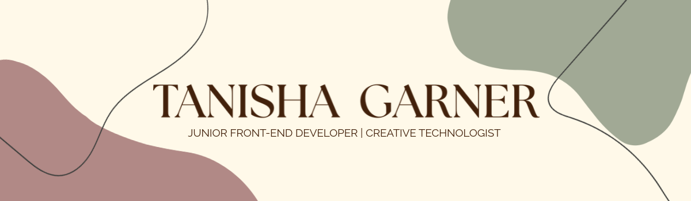

  

  <strong>Transforming brand identities into engaging, accessible digital experiences</strong>

<h2>👋 About Me</h2>

Hi! I'm Tanisha. Currently graduating from the Ira A. Fulton Schools of Engineering - Arizona state university with a BS in Full-Stack Development. Combining creativity, design and technology in the front-end development world. I also have a background in film and photography. Transferring my creative eye to a technical space. 

<h2>🔧 Tech Stack</h2>

- HTML
- CSS
- JavaScript
- jQuery
- APIs
- JSON
- Responsive Web Design
- Git & Github

<h2>🚀 Featured Projects</h2>

- <a href="https://tanishag47.github.io/Golden-Monkey-Restaurant-Website---ASU-Capstone-Project/" target="_blank">The Golden Monkey Cafe - Restaurant website</a>: Website created for an authentic Cambodian restaurant in Lynn, MA. Features include an in-app menu, image gallery, interactive homepage carousel, Google Maps integration and responsive design. 
Built with: HTML, CSS, JavaScript, jQuery and Google Maps API.

- <a href="https://tanishag47.github.io/-DISCOVER-BOSTON---TOURISM-WEBSITE/" target="_blank"> Discover Boston - Tourism website</a>: Travel destination website showcasing attractions, events, landmarks and nightlife in Boston. Features include an image carousel, interactive tabs, event listings through the Ticketmaster API and a photo gallery. 
Built with: HTML, CSS, JavaScript, jQuery UI and Ticketmaster API.

- <a href="https://tanishag47.github.io/LEGAL-SEAFOODS-CHALLENGE---RECREATION-WEBSITE/#formValid" target="_blank"> Legal Sea Foods – Recreation</a>: Designed a restaurant website concept for Legal Sea Foods, highlighting the brand's identity, history and popular dishes. Applied HTML and CSS to create a structured, responsive and user-friendly website experience. Incorporated visual design elements, typography, imagery and consistent styling to strengthen the site's presentation and usability.

<h2>🧠 What I'm Learning Now</h2>

- Improving older projects
- Deepening my understanding of back-end development and APIs
- Working with frameworks and libraries such as Bootstrap, tailwind CSS, Vue.js and React
- Working towards becoming a full-stack web developer

<h2>🌐 Check Out My Portfolio</h2>
 👉 (Portfolio link)
 

<h2>📩 Connect With Me</h2>

👾 github.com/Tanishag47

👥 linkedin.com/in/tanishagarner/ 

🌐 (Portfolio link)

***

<h2>🏖️ Fun Facts</h2>

- Taught middle school film for 2 years at non-profit after school program
- ‘Dying Light 2’ and all of ‘The Last of Us’ games as the greatest games of all time (in my humble opinion)

<!---
Tanishag47/Tanishag47 is a ✨ special ✨ repository because its `README.md` (this file) appears on your GitHub profile.
You can click the Preview link to take a look at your changes.
--->
