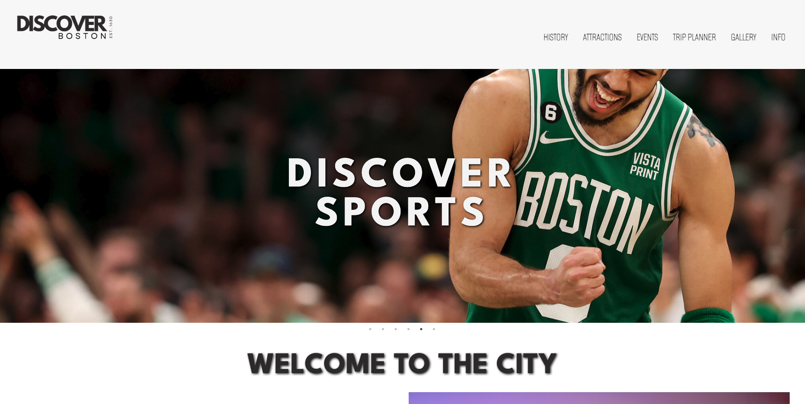

<h1>Discover Boston - Tourism Website</h1>

**GIT 418 Final Project | Front-End Web Development**  

<em></em>

<h2>Objective</h2>

The objective of this project was to design and develop a responsive tourism website that introduces visitors to Boston's attractions, popular destinations, history, and local culture. The goal was to create a centralized resource where tourists could explore what the city has to offer, discover places to visit, and find local events and experiences.

I wanted to create an engaging, easy-to-navigate platform that brings together useful travel information and interactive features, helping visitors plan their experience while showcasing the diversity and character of Boston.

<h2>Synoposis</h2>

Inspired by Boston's rich history, iconic landmarks, and vibrant city culture, Discover Boston draws from modern travel and tourism websites that make exploring new destinations accessible, interactive, and visually engaging.

The design combines informative content with an interactive browsing experience, using destination photography, organized content, and intuitive navigation to give visitors a glimpse of what the city has to offer before experiencing it in person. The overall direction emphasizes the balance between practical travel information and visual storytelling.

<h2>Process</h2>

I began by identifying the types of information tourists would find most useful when planning a visit to Boston. I organized the content into key categories, including attractions, landmarks, nightlife, and upcoming events, before developing the website's layout using HTML and CSS. My focus was on visual hierarchy, intuitive navigation, and responsive design.

Using JavaScript and jQuery UI, I incorporated interactive tabs to organize content and improve navigation. I also integrated the Ticketmaster API to dynamically display upcoming concerts, sporting events, and other local attractions, allowing visitors to explore what's happening around the city. Throughout development, I refined the interface and tested layouts across different screen sizes to maintain a consistent and accessible browsing experience.

<h2>Results</h2>

The completed project resulted in a responsive tourism website that brings together information about Boston's attractions, history, local destinations, and upcoming events in one accessible platform. Through interactive features and API integration, the website provides visitors with an engaging way to explore the city and discover local experiences.

This project strengthened my front-end development skills while further developing my understanding of responsive design, JavaScript functionality, and user-focused content organization. It also allowed me to bring together creative direction and technical implementation to create a cohesive digital experience.

<h2>Project Photos</h2>
