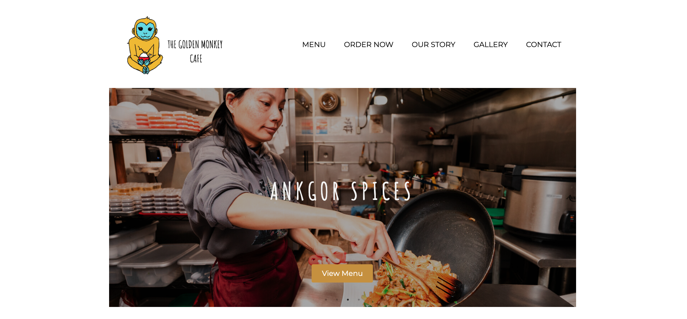

<h1>The Golden Monkey Cafe - Restaurant Website</h1>

**GIT 480 Capstone Project | Front-End Web Development**  

<h2>Objective</h2>

For my capstone project, I took on the challenge of designing and developing a responsive website for The Golden Monkey Cafe, a Cambodian restaurant in my hometown of Lynn, Massachusetts. The goal was to establish a refreshed digital presence that would introduce the restaurant to new customers while making essential information more accessible.

I wanted to create an engaging online experience that reflected the restaurant's identity, celebrated its Cambodian heritage, and highlighted its authentic cuisine. The website was designed to help customers easily explore the menu, learn about the restaurant's story, discover customer reviews, and find its location—all while strengthening the restaurant's connection with its community.

<h2>Synoposis</h2>

The website's visual direction draws inspiration from The Golden Monkey Cafe's Cambodian heritage, traditional cuisine, and family-oriented atmosphere. Rather than relying on a conventional restaurant website layout, I wanted to create a digital experience that conveyed a sense of culture, warmth, and authenticity while reflecting the personality of the business.

The design incorporates a palette of gold and red tones complemented by light blue accents, creating a balance between traditional influences and a clean, modern aesthetic. Food photography and carefully selected imagery play an important role in showcasing the restaurant's cuisine, establishing visual interest, and inviting visitors to explore the site. The overall design combines visual storytelling, intuitive navigation, and interactive elements to create an engaging experience that connects the restaurant's cultural identity with modern web design.

<h2>Process</h2>

I began by identifying the website's primary objectives and organizing its content around the information customers would find most useful. I considered how visitors would interact with the site, prioritizing intuitive navigation and an engaging user experience.

The development process centered on four key areas: **visual design, responsive development, interactive features, and API integration.** I established a color palette, typography, and layout that reflected the restaurant's brand identity. Using HTML and CSS, including Flexbox, CSS Grid, and media queries, I developed responsive layouts that adapt across different screen sizes.

To enhance functionality and engagement, I incorporated an in-site menu with direct links to the restaurant's online ordering platforms, along with jQuery-powered image carousels and interactive tabs. I also integrated the Google Maps JavaScript API to provide visitors with a convenient way to locate the restaurant.

Throughout development, my primary focus was balancing visual design with functionality, creating a cohesive digital presence that strengthened the restaurant's brand identity while providing customers with a seamless browsing experience.

<h2>Results</h2>

The completed project resulted in a responsive website that brings together the restaurant's menu, story, photography, location, and customer resources in one accessible platform. The finished product demonstrates my ability to translate a business's identity and needs into a cohesive digital experience while applying front-end development principles.

Through this project, I strengthened my skills in HTML, CSS, JavaScript, jQuery, responsive web design, and API integration. I also expanded my experience with new development tools and techniques while further developing my understanding of brand identity, visual design, and user experience.

<h2>Project Photos</h2>
