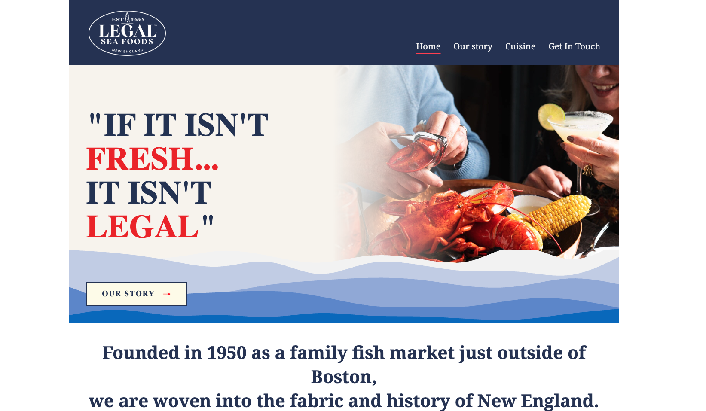
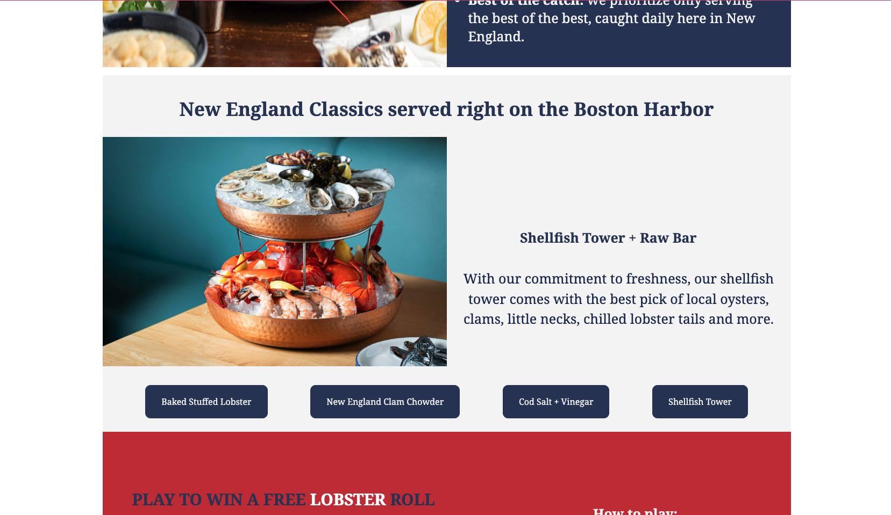
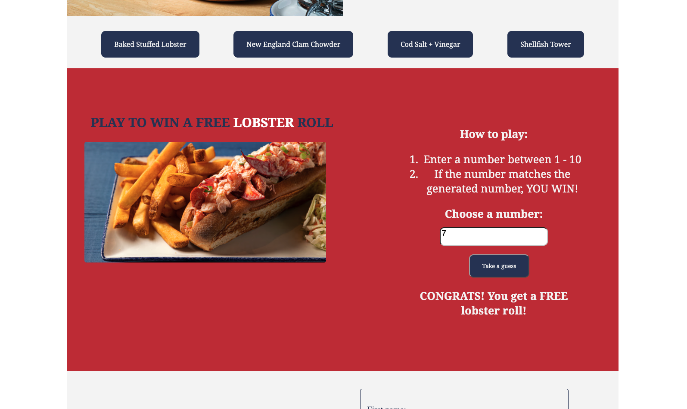
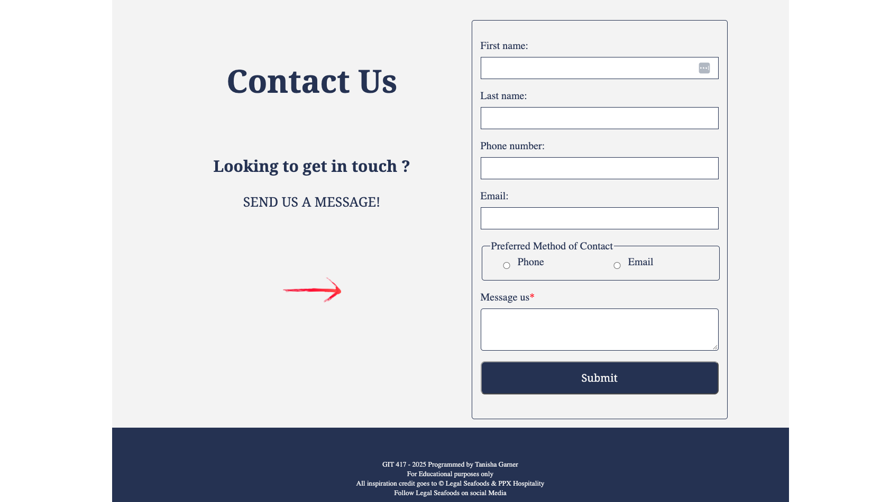

<h1>Legal Seafoods (challenge recreation) - Restaurant Website</h1>

**GIT 417 Final Project | Front-End Web Development**  

<em>Immersive Brand Introduction: Designed a focused homepage layout pairing intuitive navigation with a prominent hero section and an impactful brand slogan.</em>

<h2>Objective</h2>

This personal project was inspired by my interest in pursuing professional opportunities in restaurant website design and development. I challenged myself to recreate a website for <strong>Legal Sea Foods</strong>, a well-established New England restaurant brand, with the goal of creating an engaging digital experience that reflects its identity, and provides customers with intuitive ways to explore the brand.

My objective was to remain true to the restaurant's established digital presence and New England heritage while introducing my own design ideas and interactive features. Through this challenge, I wanted to explore how thoughtful visual design, user-friendly functionality, and front-end development techniques could come together to create a distinctive restaurant website experience.

<h2>Synoposis</h2>

Inspired by Legal Sea Foods' longstanding reputation and New England heritage, the visual direction of this project emphasizes the brand's identity as an established seafood restaurant while incorporating a modern approach to restaurant website design.

The design draws inspiration from contemporary restaurant websites that prioritize high-quality food photography, intuitive navigation, and visually engaging layouts. My goal was to create a clean, polished aesthetic that complements the brand's traditional roots while offering a fresh and engaging digital experience.

<h2>Process</h2>

Having worked at Legal Sea Foods for over four years, I brought firsthand familiarity with the brand, its customers, and its New England identity. I began by researching the company's history, target audience, and existing digital presence to establish a foundation for my design approach. From there, I explored color palettes, typography, imagery, and layout concepts that would complement the restaurant's established identity while introducing a fresh visual direction.

Using HTML, CSS, and JavaScript, I developed the website with an emphasis on usability, visual consistency, and accessibility. Key features included sections highlighting the restaurant's history and signature menu items, along with an interactive guessing game designed to encourage user engagement and add an element of interactivity to the experience.

<h2>Results</h2>

The project resulted in a responsive restaurant website concept that reinterprets the Legal Sea Foods brand through a modern, interactive digital experience. By combining brand identity, food photography, and cohesive visual design, I created a platform that emphasizes usability while providing visitors with an engaging way to explore the restaurant.

This project further strengthened my ability to translate brand research and design concepts into functional web experiences while allowing me to experiment with interactive features and expand my front-end development skills.

<h2>Project Photos</h2>

<em>JavaScript Product Switcher -  An interactive display allowing users to click through the most popular dishes offered at restaurant locations.</em>

<em>JavaScript Guessing Game -  Created an interactive guessing game for users to win a free lobster roll.
</em>

<em>Contact form validation -  Ensures users enter complete and correctly formatted information.
</em>

